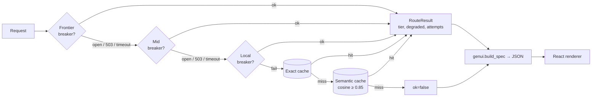

# degradation-router

An LLM request router with a fallback chain **Frontier → Mid → Local → Cache**, per-provider circuit breakers, an exact + semantic response cache, and a small generative-UI demo: the server returns a JSON component spec whose richness follows the tier that answered, and a minimal React page renders it. Availability is measured under injected 503s, timeouts and outages.

## What it is
- `router/router.py` — `DegradationRouter.route(prompt)` tries each provider in order with a per-tier timeout, skips providers whose breaker is open, and falls back to the exact cache, then the semantic cache.
- `router/breaker.py` — CLOSED → OPEN after N consecutive failures → HALF_OPEN after cooldown (one probe) → CLOSED/OPEN.
- `router/cache.py` — normalized-hash exact cache (LRU + TTL) and a semantic cache using hashed character-trigram vectors + cosine (offline lexical stand-in for an embedding model).
- `router/genui.py` — builds and validates a component spec (`page`, `banner`, `card`, `text`, `list`, `badge`, `metric`, `actions`, `button`).
- `web/index.html` — React 18 (UMD, no build step) renderer with buttons to take providers down and watch the UI degrade.

## Why
A single-provider app is as available as that provider. Chaining providers keeps answers flowing, but naive chaining pays the failed call's latency on every request. Breakers stop calling a dead provider; a cache covers a full outage for repeat questions; the UI tells the user when the answer is degraded instead of hiding it.

## Architecture


## How it works
| Tier answered | UI spec |
|---|---|
| frontier | card + badge + latency metric + attempt list + follow-up/copy actions |
| mid | info banner + card + attempt list |
| local | info banner + plain card |
| cache_exact / cache_semantic | warning banner ("cached answer", similarity shown) + plain card |
| none | error banner + retry button |

## Results
### Availability under injected faults — MEASURED on MOCKED providers
Run: `python3 bench/availability.py`. Raw output: [`results/availability.json`](results/availability.json).

Workload: 1,200 seeded synthetic support questions (12 topics × 6 paraphrase templates, Pareto-skewed, plus 15% unique long-tail questions), 20 concurrent per batch. Mock latencies: frontier ~60 ms, mid ~25 ms, local ~8 ms; timeouts 200/100/50 ms. Breaker: 3 consecutive failures, 0.5 s cooldown. The faults and latencies are injected; routing outcomes and timings are measured.

| Scenario | frontier only | chain, no breaker, no cache | chain + breaker + cache |
|---|---|---|---|
| A: frontier 30% 503s | 70.4% | **100%** (p50 68 ms) | **100%** (p50 28 ms) |
| B: frontier down for 600 req, mid 20% 503s | 50.0% | **100%** | **100%** |
| C: all providers down for last 300 req | 75.0% | 75.0% | **95.5%** |

| Scenario | Config | Failed upstream attempts | Breaker short-circuits | Tier mix |
|---|---|---|---|---|
| B | no breaker | 733 | 0 | frontier 600, mid 467, local 133 |
| B | breaker + cache | 195 | 777 | frontier 401, mid 626, local 173 |
| C | breaker + cache | 45 | 855 | frontier 900, cache_exact 243, cache_semantic 3, none 54 |

What it shows:
- The chain alone lifts availability from 50–70% to 100% when at least one provider is up. It cannot help in a total outage (C: 75%).
- The cache recovers 246 of 300 total-outage requests (C: 95.5%). The 54 misses are mostly the unique long-tail questions, which no cache can serve.
- Breakers cut failed upstream attempts by 73% in B (733 → 195) and lower p50 latency, because dead providers are skipped instead of called.
- **Trade-off found:** in A, a consecutive-failure breaker with 20 concurrent requests trips the 70%-healthy frontier 8 times, so only 159/1,200 answers came from frontier (vs 845 without breakers). Availability stays 100%, but answer quality drops to the mid tier for most traffic. A failure-*rate* window breaker would fit partial failures better; this is listed under Limits.

## Tests
23 tests (`pytest`): breaker state machine (5), caches (5), router fallback order / timeouts / breaker skip / cache tiers / seeded fault injection (8), generative-UI spec + validator + API fault-injection flow (5).

```
$ python3 -m pytest -q
.......................                                                  [100%]
23 passed
```

## Run it
```bash
pip install -r requirements.txt
python3 -m pytest -q
python3 bench/availability.py           # ~45 s, writes results/availability.json
uvicorn router.app:app --port 8001      # open http://localhost:8001 for the React demo
```

## Limits
- Providers are mocks. No real model is called; "quality" per tier is a label, not a measured score.
- The semantic cache is lexical (character trigrams), not a neural embedding. It matches paraphrases with shared wording, not true synonyms.
- The breaker counts consecutive failures; under concurrency it over-trips on partial failure (see scenario A). No sliding-window error-rate breaker yet.
- Cached answers are served without freshness checks beyond TTL; a stale answer can be wrong.
- All state is in-process. No shared cache or breaker state across replicas.
- The demo page loads React from unpkg; offline it will not render.

## Stack
Python 3.12 · FastAPI · asyncio · React 18 (UMD) · pytest

## License
MIT
